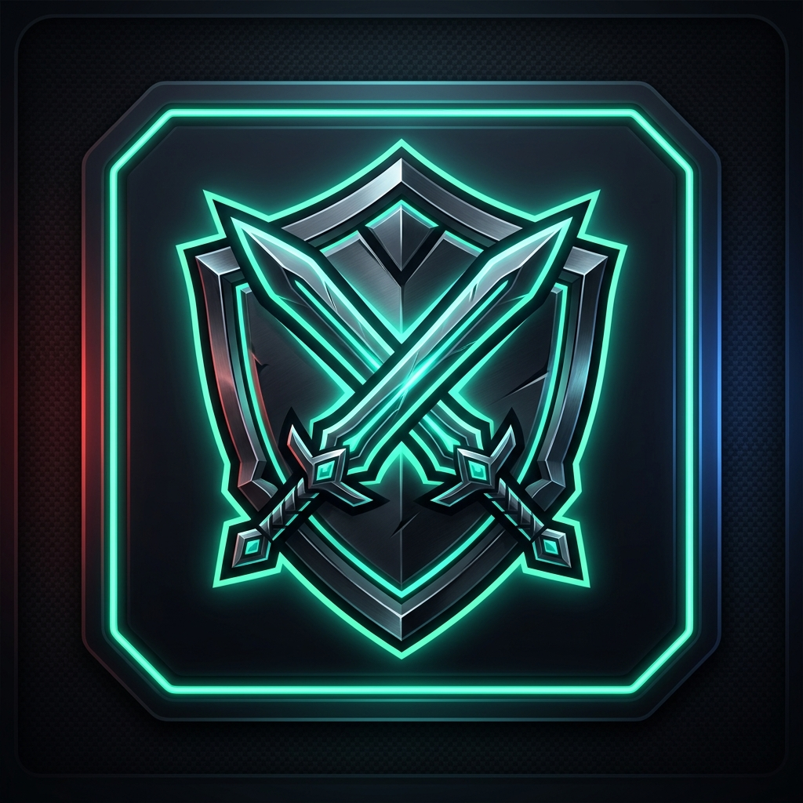

  

# EllesmereUI PvP Indicator

An [EllesmereUI](https://www.curseforge.com/wow/addons/ellesmereui) plugin for World of Warcraft that adds a PvP-flag indicator beside names on friendly "Name Only" nameplates.

## Features

- **Friendly Name-Only Indicator:** Specifically designed for EllesmereUI's "Name Only" friendly nameplate mode, showing PvP status without needing a health bar.
- **Faction Emblems & Text Options:**
  - **Faction Icon:** Displays the official Horde or Alliance PvP emblem next to the name.
  - **Text:** Display customizable text (`[PvP]`, `PvP`, `(PvP)`, or `*`) in any custom color.
- **Native EllesmereUI Options:** Configurable directly within the EllesmereUI settings panel under **PvP Indicator (EUI Plugin)** or via `/euipvp`.
- **Live Updating:** Real-time updates when players toggle PvP flag (`UNIT_FACTION`) or change settings.
- **Customizable Placement:** Adjustable offsets (X/Y) and side (Left or Right of the name).
- **Taint & Restriction Safe:** Fully compliant with EllesmereUI plugin guidelines and Midnight 12.1+ / WoW Forever nameplate restrictions.

## Slash Commands

- `/euipvp` - Opens the plugin settings in the EllesmereUI options panel.

## Requirements

- **EllesmereUI** (Core suite)
- Friendly nameplates set to **Name Only** mode in `EllesmereUI > Nameplates > Friendly`.
